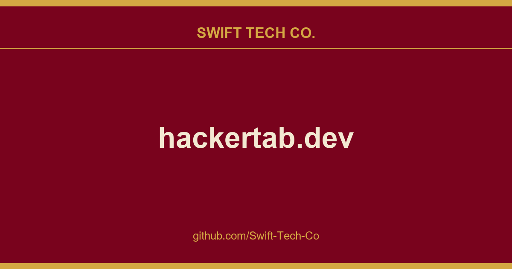

# hackertab.dev

## What This Is

A practical reference entry for product and engineering: the hackertab.dev notes, examples and fixes we reach for repeatedly. Kept current as part of the wider Swift Tech Co. engineering library.

## Images

[](https://github.com/Swift-Tech-Co/hackertab.dev)

## 👩‍💻 How to use it

- Install the extension from the Chrome store, or Mozilla add-ons
- Open a new tab
- The extension should now be running and visible
- Select your preferred programming languages and sources.
- Enjoy

## 🔥 Features

- 🆕 Daily updated content
- 💻 Customizable by programming language, framework and topic.
- 👍 Curated content from the best sources.
- 🔖 Bookmark and read it later.
- 🌙 Dark mode for when it gets late.
- ✨ AI-powered recommendations exclusively tailored to your preferences.

Even more features are going to come in the future!

## Data sources

- Github Trendings
- Hackernews
- DevTo
- Hashnode
- Lobsters
- Confs.tech
- Product Hunt
- Reddit
- Freecodecamp
- Medium
- Indiehackers
- Hackernoon
- Custom RSS Feed
- **or create an issue to ask for a new data source**

## Support

## Development

Please use the develop branch. Create an `.env` file in the root directory with the following variables:

```bash
VITE_API_URL=https://github.com/Swift-Tech-Co/hackertab.dev
VITE_BUILD_TARGET=web # or extension
VITE_BUILD_PLATFORM=chrome # optional, used for extension builds (chrome or firefox)
VITE_FIREBASE_API_KEY= # optional for local dev, required for auth features
VITE_AMPLITUDE_URL= # optional
VITE_AMPLITUDE_KEY= # optional
VITE_SENTRY_DSN= # optional
```

### Setup

Make sure you are using Node.js version 18.

```bash
$ git clone https://github.com/Swift-Tech-Co/hackertab.dev
$ cd hackertab.dev
$ yarn
$ yarn start
```

Then visit https://github.com/Swift-Tech-Co/hackertab.dev (or the port shown in your terminal).

## 🚀 Build

To build the project for different targets:

```bash
# Web build
$ yarn build:web

# Chrome extension
$ yarn build:chrome

# Firefox extension
$ yarn build:firefox
```

## Sources

Compiled and maintained from upstream [medyo/hackertab.dev](https://github.com/medyo/hackertab.dev) under permissive open-source license.

---

Maintained by [Swift Tech Co.](https://github.com/Swift-Tech-Co) - [Telegram](https://t.me/+Qt_eFvkb2rliMzNh)